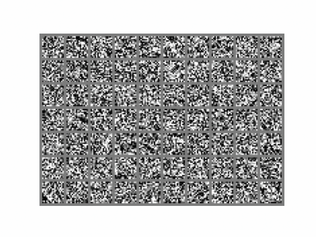
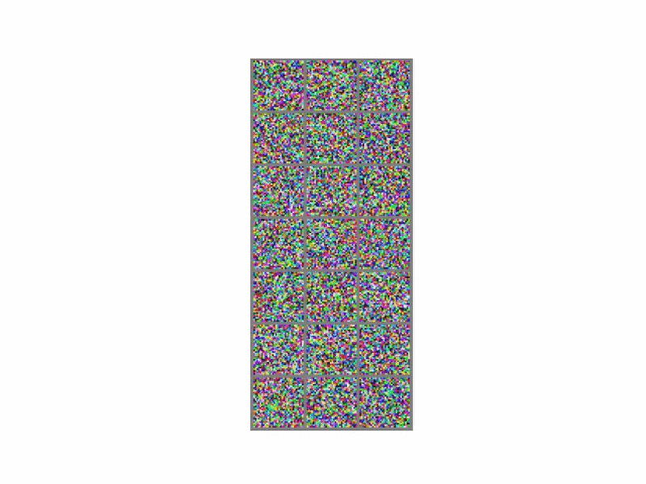

<div align="center">

# Diffusion Models from Scratch

### DDPM · Conditional U-Net · Classifier-Free Guidance · PyTorch

**Reconstruction of hands-on generative AI experiments completed during NVIDIA Deep Learning Institute training**

[Workflow](docs/WORKFLOW.md) · [Interactive Notebook](notebooks/01_diffusion_workflow.ipynb) · [Code](src/diffusion_portfolio) · [Training](scripts/train.py) · [Sampling](scripts/sample.py)

</div>

> **Project provenance:** The original learning activities were part of an NVIDIA DLI course. The author wrote code as part of those activities, but the exact final code submissions and checkpoints were later lost. This repository is an **independently written reconstruction** of the techniques learned, using archived course exercises as a technical reference. NVIDIA did not sponsor, endorse or author this repository. Preserved videos are historical course outputs, not results reproduced with these newly written source files.

## Overview

Build a simple **denoising diffusion probabilistic model (DDPM)** using a conditional U-Net to learn to remove noise. Explore how random input noise can become images through iterative reverse diffusion, and how classifier-free guidance modifies image generation for selected categories.

**Tech stack:** Python, PyTorch, torchvision, NumPy, PIL, imageio, FFmpeg. Optional: Transformers (CLIP).

## Original experimental animations

<table>
<tr><td align="center"><strong>Fashion-MNIST · grayscale</strong></td><td align="center"><strong>Flowers · RGB</strong></td></tr>
<tr><td></td><td></td></tr>
<tr><td><a href="demo/fashion.mp4">Original Fashion-MNIST video (MP4)</a></td><td><a href="demo/flowers.mp4">Original Flowers video (MP4)</a></td></tr>
</table>

These preserved animations may show noisy early-stage outputs. **Do not interpret visual noise as evidence of photorealistic or converged generation.** No original metrics or model weights survive. The videos were generated during the course and are presented as historical work.

## Architecture and concepts

```text
Image x₀ + class c
   | sample timestep t, noise ε
   v
Forward process q(xₜ | x₀) ───> noisy image xₜ
                                     |
                          [time + class embeddings]
                                     v
                           conditional U-Net
                         /        |         \
                  downsample   residual   upsample + skips
                                     |
                              estimated noise ε̂
                                     |
                        MSE(ε, ε̂) training objective
                                     |
                        reverse DDPM denoising loop
                                     v
                           new generated image
```

| Technique | Purpose | Reconstructed implementation |
|---|---|---|
| U-Net + skip connections | Preserve spatial detail while denoising | `model.py` |
| Residual convolution blocks + GroupNorm | Optimize gradient flow and stability | `model.py` |
| Sinusoidal timestep encoding | Inform model of current diffusion step | `model.py` |
| Gaussian forward diffusion | Introduce scheduled noise | `ddpm.py` |
| DDPM reverse sampler | Iteratively remove estimated noise | `ddpm.py` |
| Classifier-Free Guidance | Interpolate conditional vs unconditional estimates | `ddpm.py` |
| Class dropout | Enable unconditional training branch | `scripts/train.py` |
| GIF / MP4 exporter | Visualize samples over diffusion timesteps | `media.py` |
| CLIP embeddings (optional) | Explore image/text similarity separately | `scripts/clip_similarity.py` |

## Quickstart

Python 3.10+ recommended. CUDA-capable GPU strongly recommended for actual model training. In PowerShell:

```powershell
python -m venv .venv
.\.venv\Scripts\Activate.ps1
pip install -r requirements.txt
python -m pytest -q
```

### 1. Recreate forward-diffusion animations (no checkpoint required)

```powershell
python scripts/forward.py --dataset fashion --output demo/forward_fashion
python scripts/forward.py --dataset mnist --output demo/forward_mnist
```

Downloads the open Fashion-MNIST/MNIST data if not already present and generates GIF + MP4.

### 2. Train a diffusion model

```powershell
python scripts/train.py --dataset fashion --epochs 20 --batch-size 64 --steps 150
python scripts/train.py --dataset mnist --epochs 20 --batch-size 64 --steps 150
```

Outputs `checkpoints/fashion.pt` and `checkpoints/mnist.pt`; these are ignored by Git, so you do not accidentally publish large weights. Consider a GitHub Release only for weights that **you have actually trained and validated**.

### 3. Produce new reverse-diffusion animations

```powershell
python scripts/sample.py --checkpoint checkpoints/fashion.pt --samples 70 --guidance 2.0 --output demo/generated_fashion
python scripts/sample.py --checkpoint checkpoints/mnist.pt --samples 30 --guidance 2.0 --output demo/generated_mnist
```

Each invocation creates three files: `.png` final image grid, `.gif` timestep-by-timestep animation, and `.mp4` animated video. These are freshly generated outputs, not copies of the old course artifacts.

### 4. Recreate the flowers experiment

The original `Flores.gz` contains a cropped image collection and a `LICENSE.txt`. Because dataset redistribution rights should be checked, **the images are not included** here. Extract the original archive locally and copy its `data/cropped_flowers/` directory to this repository's `data/cropped_flowers/`.

```powershell
python scripts/train.py --dataset flowers --epochs 100 --batch-size 32 --steps 150
python scripts/sample.py --checkpoint checkpoints/flowers.pt --samples 21 --guidance 2.0 --output demo/generated_flowers
python scripts/forward.py --dataset flowers --samples 21 --output demo/forward_flowers
```

The loader automatically detects folder names through torchvision `ImageFolder`. For higher-quality results, additional training/hyperparameter tuning may be needed.

## Detailed research workflow

See **[WORKFLOW.md](docs/WORKFLOW.md)** for the forward and reverse mathematics, training objective, class dropout, sampling equations, export process, limitations and evaluation protocol.

## Project organization

```text
├── README.md
├── LICENSE                 # Independent reconstructed source only
├── requirements.txt
├── docs/
│   ├── WORKFLOW.md
│   └── GITHUB_SETUP_ES.md
├── notebooks/
│   └── 01_diffusion_workflow.ipynb
├── src/diffusion_portfolio/
│   ├── model.py             # Conditional residual U-Net
│   ├── ddpm.py              # Gaussian schedule, q(), p(), CFG
│   ├── data.py              # Data loading and normalization
│   └── media.py             # Image grids and GIF / MP4
├── scripts/
│   ├── forward.py           # Forward noising animation
│   ├── train.py             # Train and checkpoint
│   ├── sample.py            # Generate media from checkpoint
│   └── clip_similarity.py   # Optional CLIP comparison
├── tests/
│   └── test_diffusion.py
├── demo/
│   ├── fashionMNIST.gif     # Preserved course-era visualization
│   ├── flowers.gif          # Preserved course-era visualization
│   ├── fashion.mp4          # Preserved course-era video
│   └── flowers.mp4          # Preserved course-era video
├── data/                    # Locally stored data, gitignored
└── checkpoints/             # Locally trained weights, gitignored
```

## What I learned

- How forward Gaussian corruption and reverse denoising are linked mathematically.
- Why U-Net skip connections, residual layers and timestep embeddings matter for denoising.
- How to implement and compare conditional vs unconditional generation with classifier-free guidance.
- How to turn PyTorch training/inference outputs into shareable, reproducible image/video artifacts.
- How image-text alignment with CLIP differs from an image-generation model.
- Why historical demonstrations and independently regenerated outputs must be documented separately.

## Reproducibility and responsible attribution

This repository includes no instructor notebooks, course exercise content, assets, or NVIDIA branding. Original lesson notebooks corrected for personal review are **not part of the public source repository**. The independent implementation above is the source released under MIT; the archived videos are user-created outputs from the course, and the separate flower dataset is governed by its original license.

No accuracy scores, FID results, training times or model quality improvements are claimed without a measured run. The included tests verify operations, shapes and basic sampling, **not generative quality**.

For a portfolio entry: *"Independently reconstructed a PyTorch denoising diffusion workflow following NVIDIA DLI training, including a conditional residual U-Net, classifier-free guidance, image sampling and GIF/MP4 experiment visualization."*
